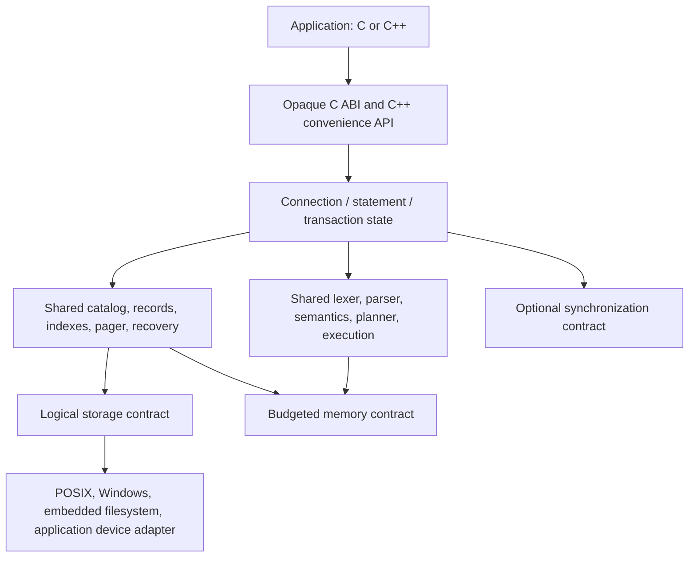

# Target portable architecture

Status: design, not implemented. See [audit](PORTABILITY_AUDIT.md) and [ADR 0010](../decisions/0010-portable-core-contract.md).

There is one semantic implementation. Build profiles select adapters and resource limits; they do not fork SQL rules. A request that exceeds a configured budget returns `RESOURCE_EXHAUSTED` with no partial commit. Unsupported storage capabilities fail at open. The current `Database`, parser, executor, snapshot, and page modules map into the boxes above; none has yet been replaced wholesale.

| Layer | Responsibility and ownership | Migration from current code |
| --- | --- | --- |
| Public API | Opaque database/connection/statement handles; caller owns configuration and callbacks; engine owns handles until close/finalize. | Wrap existing `Database` and `execute_statement`, then transition to bounded step execution. Do not expose `Value`, `Row`, `std::string`, or exceptions in C ABI. |
| SQL frontend | Tokenize and parse once per prepared statement; validate identifiers/types against catalog; no OS calls. | Keep `src/parser` grammar and tests; add configurable length/token/node/depth limits. |
| Query processing | Iterators for scan/filter/projection/limit; bounded sort/group/join with explicit spill or resource failure. | Preserve `QueryExecutor` semantics and differential tests while replacing materialized paths one operator at a time. |
| Storage | Versioned page codec, heap/catalog/index pages, allocation/reclamation, checksum and corruption checks. | Extend `page_format` and `disk_manager`; migrate `Database` tables and in-memory B-tree incrementally. |
| Pager | Cache byte cap, pin/unpin ownership, dirty tracking, eviction, and storage sync. | Extend `BufferPool`; a page guard prevents eviction while referenced. |
| Transactions | Single-writer commit, rollback, replay, checkpoint, durability outcomes. | No current transaction manager; legacy snapshot save is a compatibility path until migration. |
| Platform | Logical storage, memory, optional mutex, and only genuinely needed clock services. | Move `posix_file.cpp`, path opening, snapshot lock, and OS calls out of core target. |

The C API target should support explicit initialization/shutdown, open/close, prepare/step/reset/finalize, typed column access, explicit begin/commit/rollback, status codes, and a versioned configuration structure. Each handle has documented lifetime and thread confinement. The C++ facade may use C++20 conveniences but must not redefine database behavior. A connection creation limit and statement memory limit are configurable. Existing direct C++ APIs remain available during migration, with deprecation only after equivalent behavior and snapshot compatibility are tested.

### Migration invariants

1. Existing documented SQL returns the same rows, order, NULL behavior, type errors, and affected-row counts across profiles.
2. Only successful durable commit may be reported as committed; sync failure is an error with a documented inspect/recover state.
3. Legacy snapshots are never silently interpreted as page files. Migration is explicit and tested.
4. No profile silently removes a SQL feature. A missing resource or capability yields an explicit error.
5. The core does not call POSIX, Win32, RTOS, or raw-device APIs directly.

### Acceptance path

The first runnable slice is a Linux core plus POSIX adapter and memory fake with unchanged 15-test baseline. Next come allocation failure, C ABI, page-backed data, recovery, and cross-target gates. The current repo does not meet these invariants yet.
